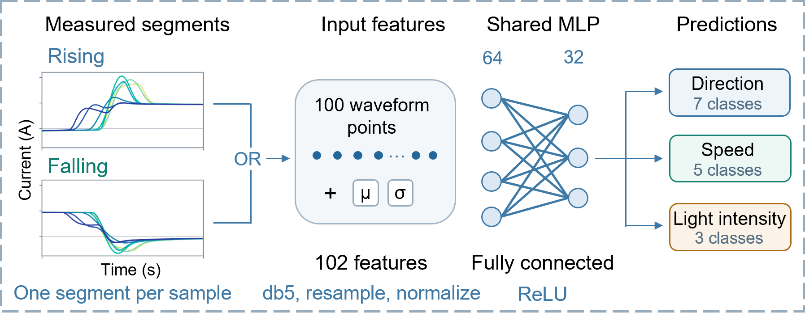
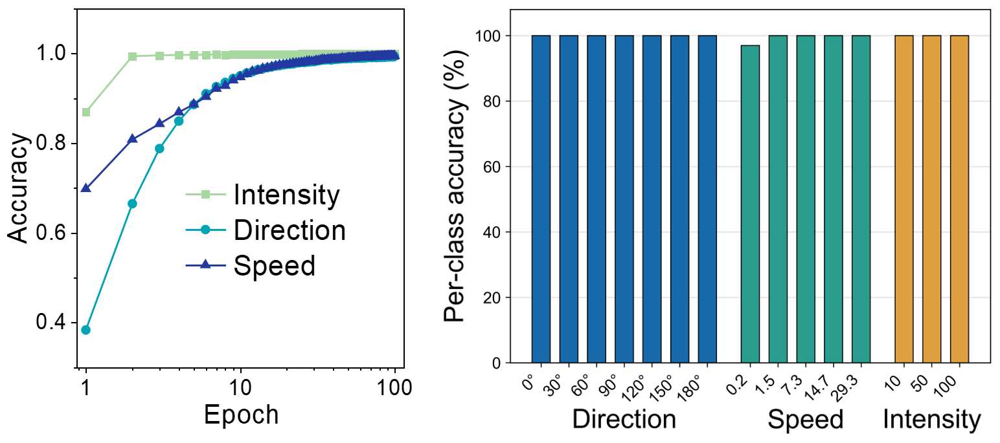

## Abstract

Reliable motion perception from visual signals is essential for intelligent systems, but conventional optical-flow methods often degrade under changing illumination or occlusion. Here we present an in-sensor encoding strategy that extracts motion information directly from photodetectors. By inserting a high dielectric constant aluminum oxide (Al2O3) layer, polarization behavior is coupled with carrier dynamics, and the asymmetric pixel design further enhances directional sensitivity. The devices encode light intensity, motion speed, and direction in the photocurrent waveforms without extra optical or electrical components. With machine-learning algorithms, the device achieves consistently high recognition accuracy over a broad speed range (0.2-30 m s-1), angular span (0-180°) and light intensity range (8.4-84.2 mW cm-2). We demonstrate real-time human–machine interaction by converting photocurrent signals generated by finger motion into commands for a block-stacking game. A 5 × 5 array and large-array simulations confirmed scalable motion estimation under dynamic illumination and occlusion. This work provides a robust hardware foundation for compact visual motion sensors

## Photocurrent data

The photocurrent response of the device under varying light intensity, motion direction, and speed.

  

## Network

The single-pixel classifier uses a lightweight multitask multilayer perceptron (MLP). Each sample is one rising or falling segment of a measured photocurrent waveform. After Daubechies-5 (db5) wavelet denoising, longer segments are linearly resampled to 100 points and shorter segments are zero-padded to that length. The 100 normalized waveform points, together with the pre-normalization mean and standard deviation, form a 102-dimensional input. Each feature is then standardized using training-set statistics. The MLP has two shared fully connected layers with 64 and 32 units, each followed by ReLU, with dropout of 0.1 after the first layer. Three linear output heads classify motion direction (7 classes), scan speed (5 classes), and light intensity (3 classes).

  

## Performance

## Environment

Python >= 3.8, PyTorch >= 1.8, NumPy >= 1.20, pandas >= 1.3, Matplotlib >= 3.4, and PyWavelets >= 1.1 are required.
